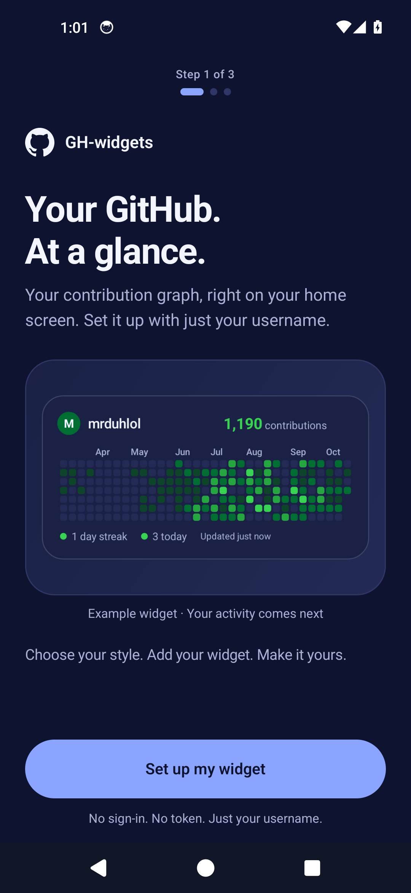
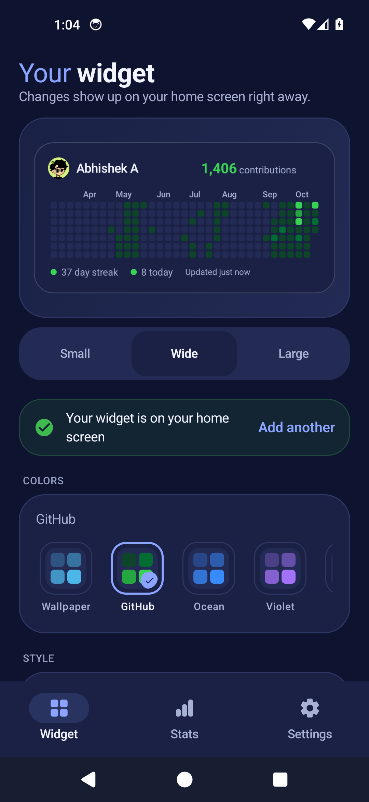
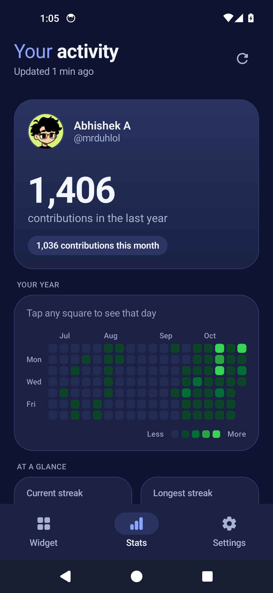

# GH-widgets

Your GitHub contributions, on your Android home screen. Set up with your username—no sign-in or token needed.

[Download the latest Android app](https://github.com/mrduhlol/github-widget/releases/latest/download/GH-widget.apk)

Choose a widget style, colors, background, and the stats you want to see. Resize it to fit your home screen, explore your activity in the app, or share your year as an image. Your last synced graph stays available offline.

Android 8.0 or newer. Each release includes the complete signed APK; install it to update your existing app.

  
  
  

