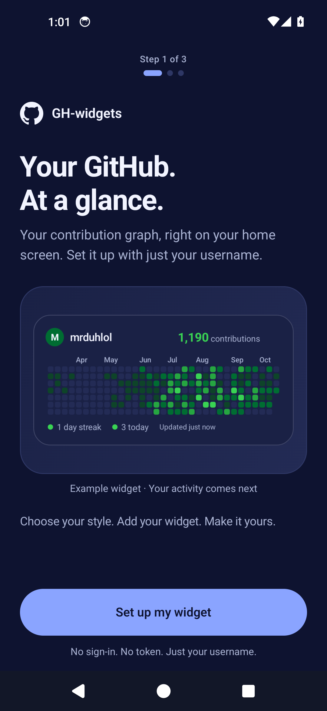
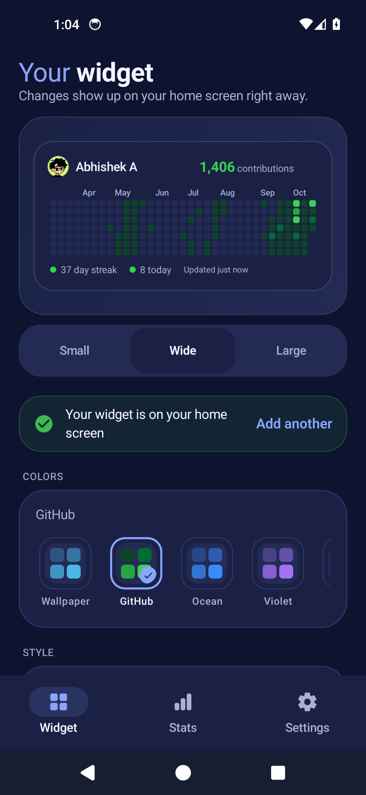
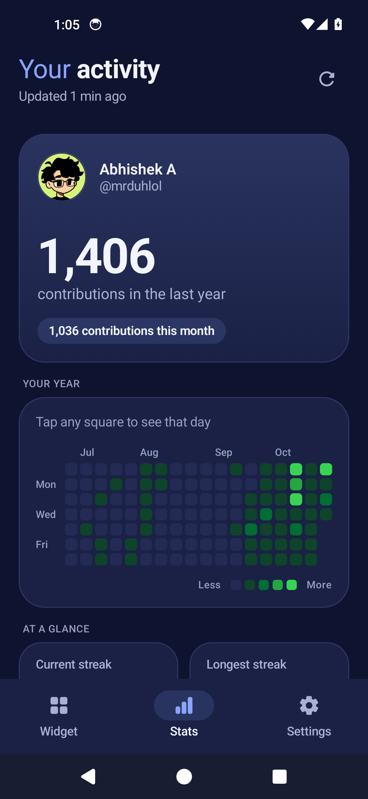

# GH-widgets

Your GitHub contributions, on your Android home screen. Set up with your username—no sign-in or token needed.

[Download the latest Android app](https://github.com/mrduhlol/github-widget/releases/latest/download/GH-widget.apk)

Choose a widget style, colors, background, and the stats you want to see. Resize it to fit your home screen, explore your activity in the app, or share your year as an image. Your last synced graph stays available offline.

New in 3.7:

- Streak and Weekly Goal widgets, plus GitHub ID cards in landscape and portrait.
- Choose which ID card details appear: photo, display name, followers, following, website, and individual public social links. Your username is always shown.
- Optional Doto dot-matrix numbers, with regular text for small labels.
- Widgets keep their own type and share the connected profile, colors, font, and visibility settings. Goals count contributions from Monday through Sunday.

Android 8.0 or newer. Each release includes the complete signed APK; install it to update your existing app.

  
  
  

